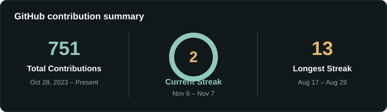
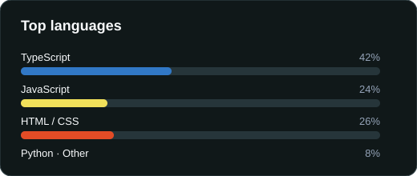
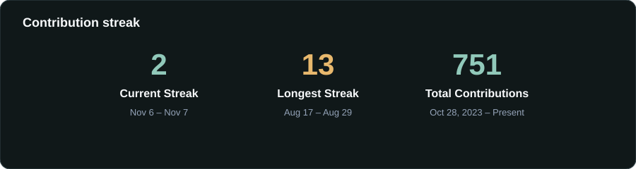
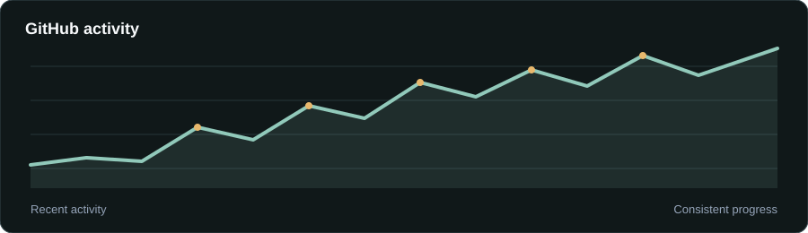

 

**`Design-minded engineer · Full-stack builder · Motion enthusiast`**

  
  
  
  

---

## ✦ Hello, I'm Ebube

I build web and mobile products that feel as good as they function. My work sits at the intersection of **product design, frontend craft, backend thinking, and expressive motion**.

I enjoy taking an idea from a rough sketch to a polished, working experience: shaping the interface, designing the system underneath it, and adding the small details that make people want to keep using it.

> **Design-minded. Engineering-driven. Always looking for the next delightful interaction.**

<table>
<tr>
<td valign="top" width="33%">

### ✦ Product experiences

Responsive products, landing pages, dashboards, and mobile interfaces with a clear visual language.

</td>
<td valign="top" width="33%">

### ◌ Motion & interaction

Type, transitions, scroll choreography, hover states, and purposeful micro-interactions that communicate.

</td>
<td valign="top" width="34%">

### ⚙ Systems that hold up

APIs, authentication, data models, search, and production-ready architecture behind the polish.

</td>
</tr>
</table>

## ✺ Selected work

<table>
  <tr>
    <td width="50%" valign="top">
      
      <h3><a href="https://www.lodemark.ai/">Lodemark ↗</a></h3>
      
<strong>Client website</strong> A confident digital front door for a managed cloud infrastructure and DevOps partner.

      Web design · Frontend · Client work
    </td>
    <td width="50%" valign="top">
      
      <h3><a href="https://under-story-pi.vercel.app/">UnderStory ↗</a></h3>
      
<strong>Dependency intelligence</strong> Trace the shortest path from an application to vulnerable code it did not write.

      Next.js · TypeScript · CognoDB · openCypher
    </td>
  </tr>
  <tr>
    <td width="50%" valign="top">
      
      <h3><a href="https://axiom-ai-ten.vercel.app/">Axiom AI ↗</a></h3>
      
<strong>AI SaaS landing page</strong> A premium marketing experience for an AI operating system concept.

      Next.js · React · TypeScript · Tailwind CSS · Motion
    </td>
    <td width="50%" valign="top">
      
      <h3><a href="https://provenance-imvs.vercel.app/">Provenance ↗</a></h3>
      
<strong>Image verification</strong> A metadata and verification system for practical coursework and fieldwork.

      Next.js · TypeScript · exifr · Better Auth · Motion
    </td>
  </tr>
  <tr>
    <td width="50%" valign="top">
      
      <h3><a href="https://hydra-plum-eight.vercel.app/">Hydra VR ↗</a></h3>
      
<strong>Immersive landing page</strong> A responsive concept introducing a virtual-reality experience.

      React · TypeScript · Tailwind CSS · Vite
    </td>
    <td width="50%" valign="top">
      
      <h3><a href="https://arise-airs.vercel.app/">ARISE ↗</a></h3>
      
<strong>Immersive aviation experience</strong> An editorial landing page for a fictional private aviation house.

      React · TypeScript · Three.js · Tailwind CSS · Vite
    </td>
  </tr>
</table>

  <a href="https://isyncplus.vercel.app/work"><strong>See all project details →</strong></a>

## ⚡ The toolkit

  

  
  
  
  
  

<strong>More about my toolkit</strong>

 

**Frontend & mobile** — React, Next.js, TypeScript, JavaScript, Flutter, React Native, Tailwind CSS, HTML, and CSS.

**Backend & data** — Node.js, Express, PostgreSQL, MongoDB, Prisma, Supabase, REST APIs, JWT, and graph-powered systems.

**Languages & tools** — Python, C#, Git, GitHub, VS Code, Postman, Chrome DevTools, Vercel, and SEO writing.

## ◈ GitHub in motion

  
  

 

  

 

  

## ⌁ Currently

- Building products that combine **strong visual direction with solid engineering**
- Exploring better ways to model and explain **complex relationships in data**
- Experimenting with **motion, 3D, and interaction design**
- Open to thoughtful collaborations, freelance work, and interesting problems

## ↗ Find me online

  
  
  
  

 

### Have something in mind?

**[Let’s make it matter →](https://isyncplus.vercel.app/contact)**

 

Built with curiosity, care, and a little bit of motion by iSyncPlus.

